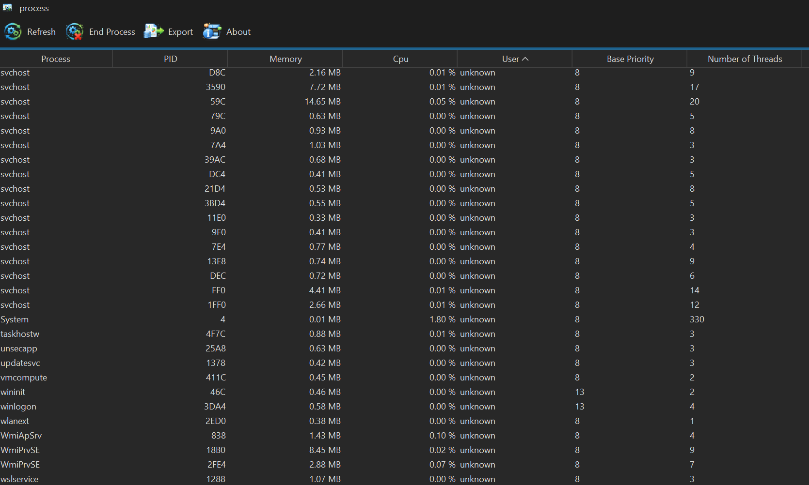

# Visor de procesos

Aplicación de escritorio que muestra los procesos del sistema operativo (nombre, PID, memoria, CPU, usuario, prioridad, hilos y ruta) y permite terminarlos o exportarlos.

## Características

- Lista de procesos que se actualiza sola cada 5 segundos, sin congelar la ventana.
- Ordenamiento por cualquier columna (los números se ordenan como números).
- Terminar un proceso (con confirmación previa).
- Exportar la lista a un archivo de texto.
- Interfaz moderna con el tema oscuro FlatLaf.
- Multiplataforma gracias a la biblioteca OSHI.

## Requisitos

- JDK 21 y Maven 3.9 o superior.

## Compilar y ejecutar

```bash
mvn clean package
java -jar target/mvn-process-1.0-0-launcher.jar
```



## Notas

- Terminar procesos del sistema o de otros usuarios requiere permisos de administrador.
- El PID se muestra en hexadecimal.

## Licencia

Código de ejemplo de uso libre con fines educativos.
